# Sobel Edge Detection Accelerator Using Verilog
## Complete RTL-to-GDSII Implementation Using SKY130

### 1. Project Overview

In this project, I designed and implemented a Sobel Edge Detection Accelerator using Verilog HDL and the SKY130 standard-cell library.

My objective was to understand and implement the complete RTL-to-GDSII VLSI design flow, starting from RTL design and functional verification through physical design, routing, timing analysis and layout verification.

I performed this project on Ubuntu Linux running inside Oracle VirtualBox, using open-source VLSI tools.

### 2. Tools Used

- Verilog HDL
- Icarus Verilog and GTKWave
- Yosys
- OpenROAD
- OpenSTA and OpenRCX
- KLayout
- Magic
- Netgen
- SKY130 HD Standard-Cell Library
- Ubuntu Linux in Oracle VirtualBox

### 3. RTL-to-GDSII Design Flow

I completed the following stages:

1. RTL design
2. Functional simulation
3. Logic synthesis
4. Floorplanning
5. Standard-cell placement
6. Clock Tree Synthesis (CTS)
7. Power Distribution Network (PDN)
8. Global routing
9. Detailed routing
10. Parasitic extraction
11. Static Timing Analysis (STA)
12. GDSII generation
13. Design Rule Checking (DRC)
14. Layout Versus Schematic (LVS) comparison

### 4. RTL Design and Functional Verification

I developed the Sobel Accelerator RTL using Verilog.

I verified the functionality using simulation testbenches and checked the generated waveforms.

The functional RTL simulation and gate-level simulation passed.

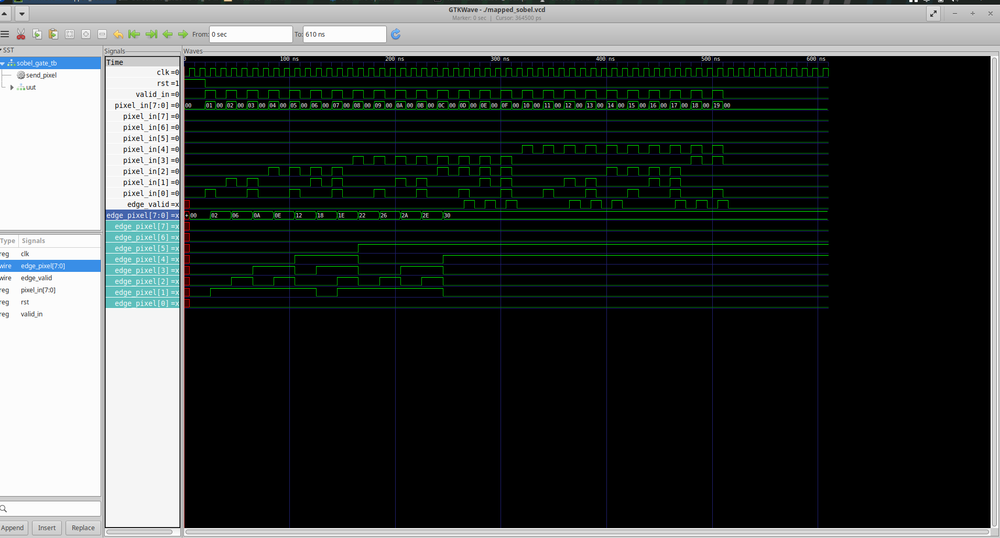

### 5. Logic Synthesis

I used Yosys to convert the RTL design into a SKY130 standard-cell gate-level netlist.

I analyzed the synthesized design and generated a schematic.

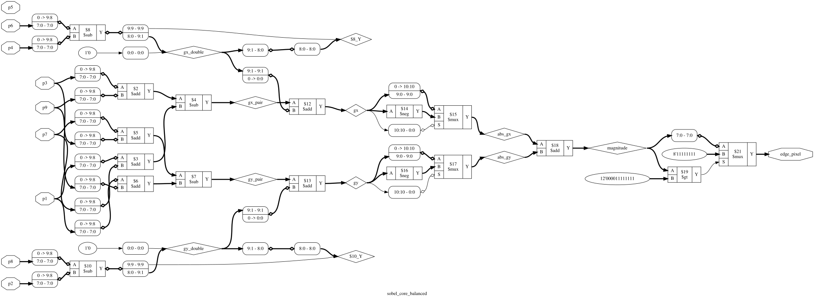

### 6. Physical Design

Using OpenROAD, I performed:

- Floorplanning
- Standard-cell placement
- Power distribution
- Clock Tree Synthesis
- Global routing
- Detailed routing

The final routed design contains 984 standard-cell instances, including 17 CTS clock buffers.

The routed DEF and OpenROAD database are available under:

`physical_design/routing/`

### Physical Design Screenshots

The following screenshots document the major stages of my RTL-to-GDSII implementation.

#### Floorplanning

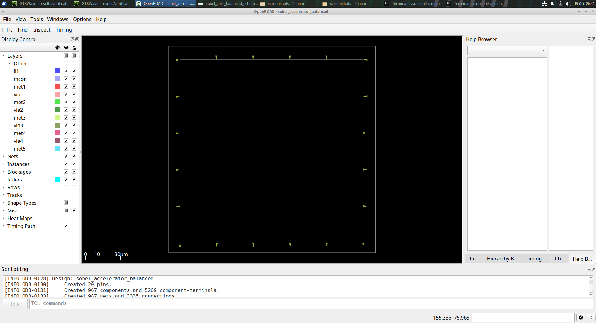

#### Standard-Cell Placement

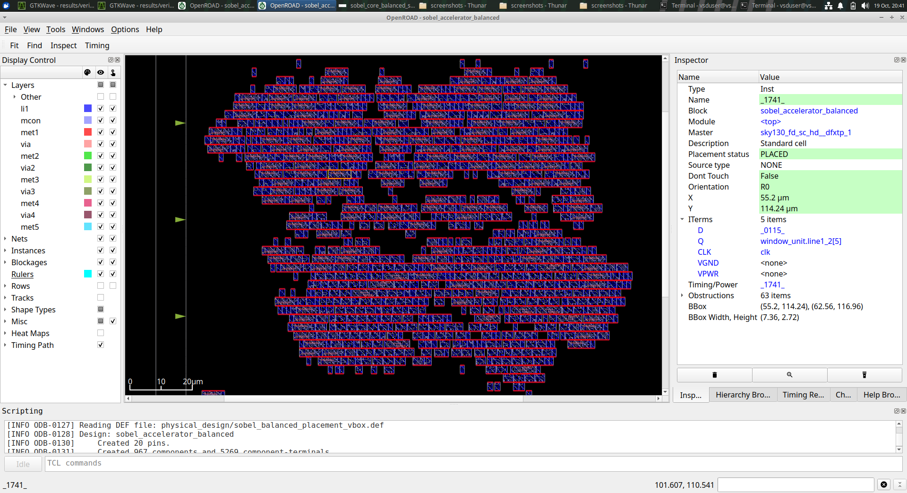

#### Detailed Placement

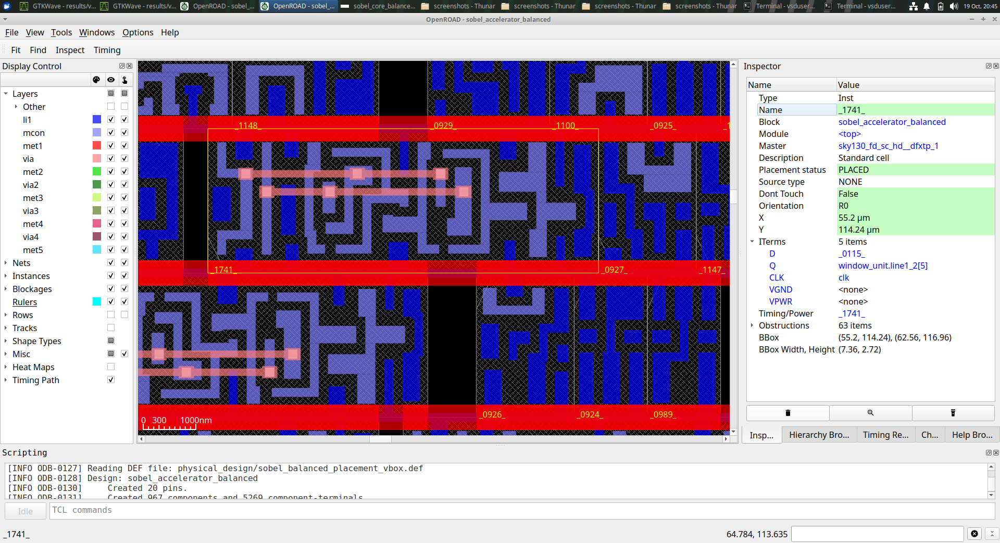

#### Clock Tree Synthesis

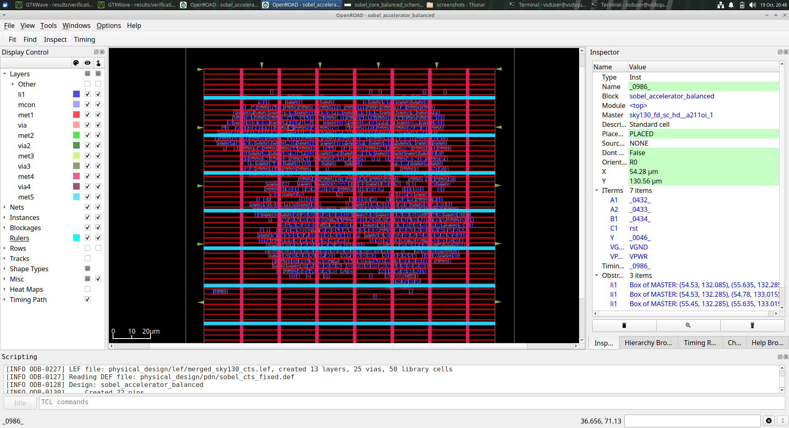

#### Detailed Routing

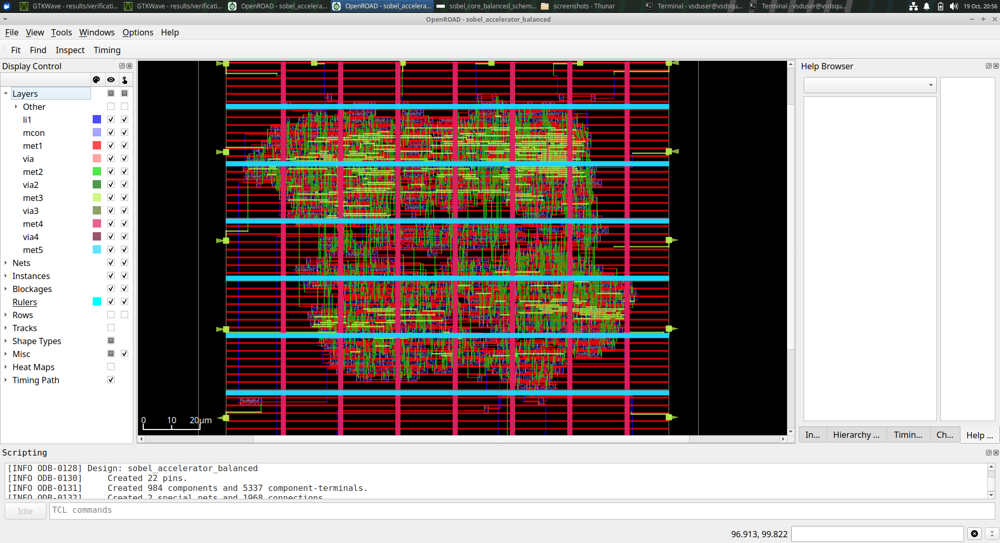

#### Routed Clock Buffer

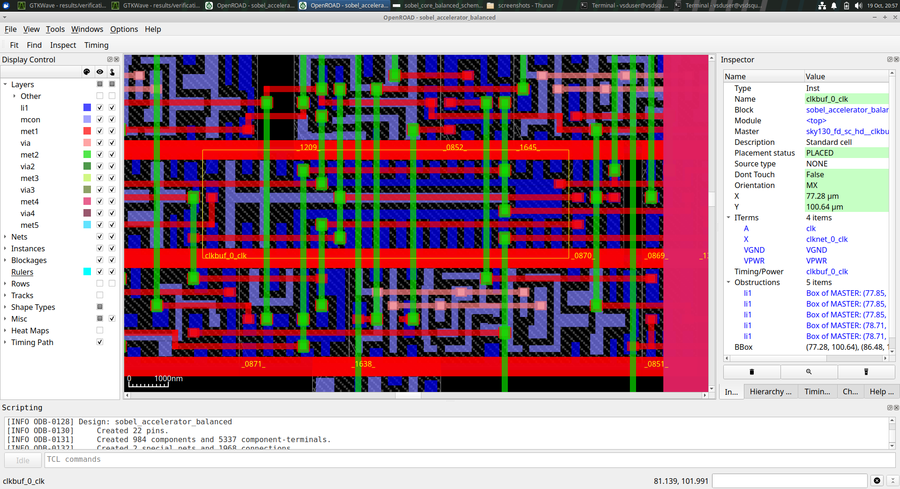

### 7. GDSII Generation

After completing routing, I generated the GDSII layout.

Initially, the GDSII did not contain the complete standard-cell internal geometry.

I investigated the missing geometry and merged the actual SKY130 standard-cell GDS files into the layout.

This produced the full-cell GDSII:

`results/gds/sobel_accelerator_balanced_fullcells.gds`

### 8. Static Timing Analysis

I performed post-route parasitic extraction using OpenRCX and generated STA reports for 16 SKY130 timing corners.

I analyzed setup and hold timing behavior across the corners.

Some corners still show timing violations, so timing closure remains future work.

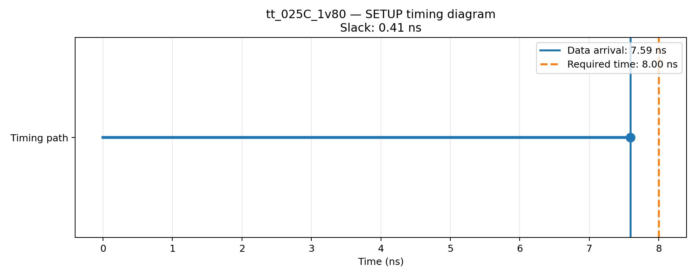

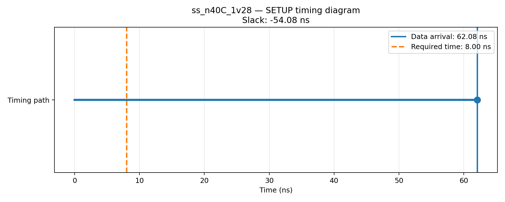

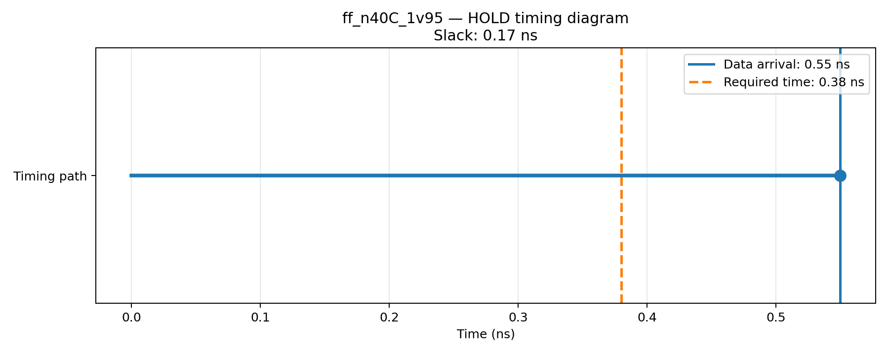

The complete summary is available at:

`results/sta/extracted_rc_all_corners/summary.csv`

### Detailed STA Reports and Graphs

I organized the setup, hold, and gate-by-gate timing results separately for all 16 corners.

**[View complete 16-corner STA evidence](STA_ALL_CORNERS.md)**

### 9. Design Rule Checking

I ran KLayout DRC using the available SKY130 rule deck.

The completed run reported zero DRC violations.

This result applies to the tested rule deck and does not constitute foundry signoff.

### 10. Layout Versus Schematic

I used Magic for layout extraction and Netgen for LVS.

Initially, the synthesis-based reference did not account for the clock buffers added during CTS.

To improve the comparison, I exported the post-route netlist from OpenROAD and generated a reference SPICE netlist.

Netgen confirmed that both circuits contained 984 devices.

However, connectivity mismatches remained, including an extracted short involving `pixel_in[4]` and VGND.

**LVS status: Not passed.**

### 11. Challenges Faced and Troubleshooting

#### Challenge 1: Standard-Cell Library Configuration

During synthesis and physical-design setup, I encountered issues related to standard-cell libraries and tool configuration.

I inspected the errors, verified the required library files and corrected the configuration before continuing.

#### Challenge 2: Physical-Design Flow Errors

I faced several difficulties while configuring placement, CTS and routing.

I analyzed OpenROAD logs, checked the design settings and retried the affected stages after making corrections.

Eventually, I completed detailed routing and generated the routed design database.

#### Challenge 3: Incomplete GDSII Geometry

The initial GDSII contained cell references without complete transistor-level standard-cell geometry.

I identified the missing geometry and merged the original SKY130 standard-cell GDS files.

This allowed me to generate a more complete layout for physical verification.

#### Challenge 4: Multi-Corner Timing Analysis

Generating timing reports across multiple process, voltage and temperature corners required the correct timing libraries and parasitic extraction.

I configured the timing analyses and generated reports for 16 SKY130 corners.

The remaining setup and hold violations were recorded for future optimization.

#### Challenge 5: LVS Connectivity Mismatch

My initial LVS comparison showed a difference between the synthesized reference and the routed layout.

I identified that CTS had introduced additional clock buffers.

I exported the post-route netlist and reconstructed the reference SPICE using SKY130 CDL pin definitions.

This resolved the device-count mismatch, but the LVS connectivity mismatch is still unresolved.

### 12. Final Results

| Parameter | Result |
|---|---|
| RTL simulation | PASS |
| Gate-level simulation | PASS |
| Logic synthesis | Completed |
| Floorplanning and placement | Completed |
| Clock Tree Synthesis | Completed |
| Detailed routing | Completed |
| Final standard-cell instances | 984 |
| CTS clock buffers | 17 |
| Full-cell GDSII | Generated |
| KLayout DRC | 0 reported violations |
| Post-route STA | 16 corners analyzed |
| Timing closure | Not achieved |
| Netgen LVS | Connectivity mismatch remains |

### 13. What I Learned

Through this project, I gained practical experience in the complete RTL-to-GDSII flow.

I learned how to:

- Design and verify digital hardware using Verilog.
- Perform synthesis using SKY130 standard cells.
- Implement floorplanning, placement, CTS and routing.
- Generate and inspect GDSII layouts.
- Analyze timing across different corners.
- Run DRC and LVS checks.
- Debug errors using tool logs and intermediate design files.
- Document results and identify remaining design limitations.

### 14. Future Scope

- Resolve LVS connectivity mismatches.
- Achieve setup and hold timing closure.
- Repeat verification after correcting the remaining issues.
- Improve performance and area.

### Conclusion

This project provided hands-on experience in digital VLSI design and physical implementation.

I successfully implemented the Sobel Accelerator through detailed routing and full-cell GDSII generation.

Functional simulations passed, and KLayout DRC reported zero violations under the tested rule deck. Timing closure and LVS connectivity verification remain incomplete and are documented for future improvement.
